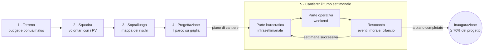

# Costrui-AMO: un Parco! — Game Design Document

Aggiornato al 13/11/2026 · Marco Pignataro (Puli-AMO Messina)

> Questo file è il riferimento per lo sviluppo: quando una decisione cambia, si aggiorna qui insieme al codice.
> Il titolo è provvisorio: nel codice vive solo in `src/config.ts` (`GAME_TITLE`).

## Visione e concept

Costrui-AMO: un Parco! è un gestionale in pixel art per browser: il giocatore guida un'associazione di volontari dalla scelta di un terreno abbandonato all'inaugurazione di un parco urbano. L'ambientazione è una Messina riconoscibile, ma terreni, enti e fatti sono di fantasia; le difficoltà sono quelle che Puli-AMO Messina vive davvero.

**Pitch in una riga:** trasforma un terreno dimenticato in un parco, con pochi soldi, tanti volontari e una burocrazia da domare.

**Perché serve all'associazione**

- Fa capire in modo accessibile cosa c'è dietro un progetto di rigenerazione urbana, anche a chi non legge i comunicati.
- Avvicina giovani e potenziali volontari: chi gioca capisce cosa significa fare rigenerazione urbana.
- Strumento educativo per scuole e laboratori (cittadinanza attiva, beni comuni, sicurezza in cantiere).
- Canale di visibilità e di raccolta fondi (donazione libera, link al 5x1000).

**Pubblico:** dai 12-14 anni in su, cittadini messinesi, giocatori casual di gestionali.

**Pilastri di design**

1. **Realismo civico** — ogni meccanica corrisponde a un problema vero: terreni difficili, permessi, materiali, volontari che si stancano.
2. **Ogni scelta ha un costo** — soldi, tempo e persone sono le tre valute in tensione; non esiste la scelta gratuita.
3. **Varietà di gioco** — gestionale, esplorazione, modalità creativa e mini-dungeon si alternano per non stancare.
4. **Ironia, mai cinismo** — la burocrazia si prende in giro con affetto; il messaggio finale è che il cambiamento si può fare.

**Riferimenti:** Two Point Hospital (tono ironico, gestione), Prison Architect (progettazione su griglia), Stardew Valley (pixel art, comunità), Papers, Please (burocrazia come gameplay).

## Struttura di gioco e core loop

Una partita attraversa quattro fasi preparatorie, giocate una volta sola, poi entra nel ciclo settimanale del cantiere, che si ripete fino all'inaugurazione.

Le scelte fatte nelle fasi 1-4 (terreno, squadra, rischi scoperti, progetto) decidono quanto sarà lungo e costoso il cantiere. La partita non ha una durata prefissata: dura quanto serve a completare il parco.

### Il turno settimanale

Ogni turno è una settimana di gioco divisa in due parti, ma i compiti scorrono in tempo reale: è un gioco a timer da riaprire più volte al giorno. Il giocatore non muove i volontari: decide *chi* fa *cosa* e *con quali strumenti*, poi i volontari lavorano sia a gioco aperto sia a gioco chiuso.

1. **Parte burocratica (infrasettimanale).** Vale 5 giorni da 4 ore, cioè 20 ore di sessione. Si scelgono volontari e strumenti d'ufficio (telefono, computer, PEC, marche da bollo, modulistica) e si assegnano a pratiche, ordini di materiali, contatti con sponsor, raccolte fondi. Le 20 ore sono tempo reale con almeno un compito in corso (compiti paralleli contano una volta). La sessione si chiude da sola a 20 ore, oppure manualmente: in quel caso i giorni rimanenti passano comunque e le attese delle pratiche avanzano.
2. **Parte operativa (weekend).** Si scelgono i volontari e gli attrezzi (pale, carriole, decespugliatori, DPI, mezzi a noleggio) e si assegnano ai compiti di cantiere. Vale 1 giorno da 8 ore: si chiude da sola a 8 ore di attività, oppure manualmente.
3. **Esecuzione in tempo reale.** Ogni compito ha un timer reale: un compito da 5 ore finisce 5 ore dopo, anche a gioco chiuso. Nel frattempo si possono assegnare altri compiti ai volontari liberi.
4. **Resoconto del compito.** A fine compito appare un resoconto in una finestra modale: subito se il gioco è aperto; alla riapertura, in coda con gli altri resoconti, se il gioco era chiuso.
5. **Fine della settimana.** Dopo la parte operativa arriva il resoconto settimanale (eventi, morale, bilancio) e si apre la parte burocratica della settimana dopo.

**Durata dei compiti.** Ogni compito ha una durata complessiva in ore di lavoro. Più volontari se la dividono; le skill adatte la riducono ancora e alzano la qualità.

| Squadra su "Riparare una panchina" (10 ore complessive) | Durata reale | Qualità |
| --- | --- | --- |
| 1 volontario base | 10 ore | Base |
| 2 volontari base | 5 ore | Base |
| 1 falegname | 9 ore | Alta |
| 1 falegname + 2 volontari base | circa 2 ore | Alta |

**Formula.** La durata reale è il totale delle ore diviso la somma delle efficienze dei volontari assegnati: `T = H / Σ eᵢ`.

H sono le ore complessive del compito; e vale 1 per un volontario base, 1,1 per uno specialista con la skill giusta e 2 per un volontario base guidato da uno specialista (*effetto guida*: lo specialista coordina e insegna). Nell'ultimo esempio: 10 / (1,1 + 2 + 2) ≈ 2 ore. Senza effetto guida la stessa squadra impiegherebbe circa 3 ore.

**Limiti.** Ogni compito ha un numero massimo di volontari (es. panchina: 3) e uno specialista guida al massimo 2 volontari base, così i tempi non si azzerano. La qualità dipende dalla skill più alta presente nel gruppo. Un compito si può avviare solo se finisce entro le ore residue della sessione (regola introdotta nel prototipo).

**L'agenda dei volontari.** Un volontario impegnato in un compito resta occupato finché il timer non scade. Ogni volontario ha un monte ore settimanale unico, da spendere in entrambe le parti (6 ore base, 10 per i mestieri, 14 per i ruoli organizzativi), e ogni strumento serve un compito alla volta. Decidere come dividere persone e strumenti tra i compiti è la sfida principale.

## Risorse ed economia

Il gioco ruota su sei risorse: tre "dure" (budget, punti volontariato, tempo) e tre "morbide" (morale, reputazione, fiducia degli uffici) che moltiplicano o frenano le prime.

| Risorsa | Come si ottiene | Come si consuma | Se si esaurisce |
| --- | --- | --- | --- |
| Budget (€) | Dotazione iniziale del terreno, raccolte fondi, sponsor, bandi | Materiali, noleggio mezzi, ditte, diritti e bolli | Lavori fermi; dopo N settimane in rosso, game over |
| Punti volontariato (PV) | Dotazione iniziale, task completati, eventi pubblici, reputazione | Reclutare volontari, sbloccare skill | Nessun nuovo ingresso in squadra |
| Tempo (calendario) | — scorre sempre | Ogni lavorazione e pratica | Concessione scaduta, logoramento dei volontari |
| Morale della squadra | Traguardi, eventi sociali, riposo, riconoscimenti | Fatica, fallimenti, attese, durata del progetto | Volontari che abbandonano |
| Reputazione cittadina | Lavori visibili, comunicazione social, eventi nel quartiere | Cantiere fermo, polemiche, vandalismi non gestiti | Raccolte fondi meno efficaci, meno PV |
| Fiducia per ufficio | Side-quest completate, pratiche consegnate corrette | Documenti sbagliati, solleciti eccessivi | Pratiche più lente presso quell'ufficio |

**Le interazioni chiave**

- **Reputazione → PV e fondi:** più il quartiere vede il parco crescere, più gente si unisce e dona.
- **Morale → produttività:** un volontario demotivato lavora più lento e sbaglia di più.
- **Tempo → morale:** oltre una soglia di durata il morale cala da solo ogni settimana. È la meccanica che rende reale il "si perdono volontari se il progetto dura troppo".
- **Fare a mano vs pagare:** quasi ogni lavoro si può pagare in euro (ditte, mezzi) o in fatica dei volontari. Il giocatore bilancia continuamente le due valute.

**Unità di tempo:** il turno settimanale in-game, diviso in parte burocratica e parte operativa. I compiti durano ore reali: il tempo del giocatore è la risorsa che scorre, le ore dei volontari quella che si spende.

## Fase 1 — Scelta del terreno

Ogni partita parte da una mappa della città con 4-6 terreni disponibili: più un terreno è difficile, più budget e PV iniziali dà, e più alto è il moltiplicatore di punteggio finale.

| Fattore | Valori possibili | Effetto in gioco |
| --- | --- | --- |
| Pendenza | Pianeggiante · moderata · forte | Costi di movimento terra, sentieri più cari, rischio smottamenti con la pioggia; bonus "panorama" sul gradimento |
| Pulizia | Rifiuti leggeri · ingombranti · discarica abusiva · materiali pericolosi | Giorni di bonifica; i materiali pericolosi richiedono per forza una ditta specializzata |
| Tipo di terra | Argillosa · sabbiosa · rocciosa · terreno di riporto | Drenaggio, attecchimento delle piante, fatica di scavo |
| Sottosuolo | Pulito · sottoservizi · cavità · falda alta · reperti | Fonte principale delle insidie nascoste (Fase 3) |
| Distanza dal centro abitato | Centrale · periferica · isolata | Centrale: più volontari e visibilità, ma più lamentele e vandalismi. Isolata: l'opposto, con logistica più cara |
| Proprietà | Comunale · demaniale · privata in comodato · bene confiscato | Determina quali pratiche servono e con quali uffici |
| Vegetazione esistente | Nessuna · infestanti · alberi da tutelare | Costi di sfalcio; alberi tutelati vincolano il progetto ma alzano il gradimento |

**Scheda terreno.** Ogni terreno mostra una valutazione di difficoltà da 1 a 5, il budget e i PV iniziali e un'immagine in pixel art. Prima del sopralluogo alcuni fattori sono indicati come "?": si vede la superficie, non quello che c'è sotto.

**Bonus e malus di partenza (esempi)**

- *Area vicino a una scuola:* +20% PV dai genitori, ma vincoli di sicurezza più severi su recinzioni e giochi.
- *Bene confiscato:* forte reputazione iniziale, ma pratiche più lunghe.
- *Torrente tombato:* terreno pianeggiante ed economico, rischio allagamento con eventi meteo.
- *Collina panoramica sullo Stretto:* massimo gradimento potenziale, pendenza e logistica difficili.

**Ambientazione.** Messina riconoscibile: lo Stretto, le colline, i torrenti, i quartieri e i monumenti fanno da sfondo. Terreni e fatti invece sono inventati: nessun terreno di gioco corrisponde a un luogo reale specifico.

**Prototipo.** Tre terreni in `src/data/sites.json`: *Giardino dietro la scuola* (difficoltà 1, 350 €, 18 PV, ×1), *Ex deposito sul torrente* (2, 450 €, 22 PV, ×1,2) e *Collina sullo Stretto* (4, 650 €, 28 PV, ×1,6). Ogni scheda mostra descrizione, fattori e bonus; tipo di terra e sottosuolo restano "?" fino al sopralluogo. Cliccando "Guarda sulla mappa" il terreno compare nella scena con il suo progetto proposto; si può cambiare idea finché non si conferma. Per ora fattori e bonus sono solo descrittivi: avranno effetto con sopralluogo, eventi e punteggio.

## Fase 2 — Squadra di volontari

Il giocatore spende i PV iniziali per comporre la squadra: i volontari base costano poco, gli specialisti costano di più ma sbloccano lavorazioni, riducono costi o velocizzano pratiche.

| Archetipo | Skill principale | Costo PV (indicativo) | Ore a settimana | Effetto |
| --- | --- | --- | --- | --- |
| Volontario base | Braccia | 1 | 6 | Pulizia, trasporto, lavori semplici |
| Studente | Braccia + apprendimento | 1 | 6 | Economico, sale di livello più in fretta, meno disponibile in sessione d'esame |
| Giardiniere / agronomo | Verde | 3 | 10 | Piantumazione, analisi del terreno, piante che attecchiscono meglio |
| Artigiano del legno | Costruzione | 3 | 10 | Panchine e recinzioni autocostruite, recupero di materiali |
| Fabbro / saldatore | Metallo | 3 | 10 | Ringhiere, cancelli, riparazioni di giochi |
| Elettricista / idraulico | Impianti | 4 | 10 | Necessario per punti luce e acqua senza ditta |
| Geometra / architetto | Progetto | 4 | 10 | Più strumenti in progettazione, rivela pendenze e confini nel sopralluogo |
| Esperto di carte | Burocrazia | 4 | 14 | Pratiche più veloci, meno documenti sbagliati |
| Comunicatore / social | Comunicazione | 3 | 14 | Raccolte fondi più efficaci, reputazione in crescita |
| Coordinatore | Leadership | 5 | 14 | Alza il morale di tutta la squadra, riduce gli abbandoni |
| Presidente | Rappresentanza | 6 | 14 | Uno solo in squadra; bonus nelle richieste dirette ai dirigenti e nella fiducia degli uffici |
| Segretario/a | Organizzazione | 5 | 14 | Uno solo in squadra; gestisce il registro delle pratiche, meno errori, avvisi anticipati sulle pratiche bloccanti |

Il monte ore è settimanale e unico: si spende sia nella parte burocratica sia in quella operativa. I valori sono il punto di partenza, da bilanciare nel prototipo.

**Attributi di ogni volontario:** energia, morale, ore disponibili a settimana, livello di skill, uno o due tratti di carattere (es. *puntuale*, *polemico*, *sempre col caffè*, *esperto di riciclo*). I tratti creano piccole storie e sinergie tra volontari.

**Crescita:** i volontari guadagnano esperienza lavorando e possono imparare una seconda skill affiancando uno specialista. I nuovi PV arrivano da task completati, eventi pubblici e reputazione.

**Perdita di volontari**

- **Morale basso** prolungato: il volontario annuncia che "si prende una pausa" e poi esce.
- **Sovraccarico:** troppe giornate consecutive senza riposo.
- **Logoramento:** oltre una durata soglia del progetto, ogni settimana cresce la probabilità di abbandono.
- **Infortuni lievi:** più probabili senza DPI e formazione. Insegna che la sicurezza in cantiere conta.
- **Conflitti** tra tratti incompatibili assegnati allo stesso task.

**Contromisure:** eventi sociali (grigliata, pizzata di fine cantiere), riconoscimenti pubblici, turni di riposo, acquisto di DPI.

**Prototipo.** Si recluta da un elenco di 17 candidati (`src/data/candidates.json`) spendendo i PV del terreno; ogni volontario si può anche congedare e i PV tornano indietro, finché la squadra non è confermata. Presidente e segretario/a sono unici; servono almeno 3 volontari. I PV avanzati restano per il futuro (reclutamenti in corso di partita). Energia, morale, tratti e crescita non ci sono ancora.

## Fase 3 — Sopralluogo

Il sopralluogo è una fase di esplorazione a tempo: il giocatore manda 3-4 volontari ad analizzare i punti sospetti del terreno e deve scoprire le insidie prima che si trasformino in imprevisti costosi in cantiere.

**Come funziona**

- **Un giorno di sopralluogo:** ogni analisi è un compito a timer reale (es. 2-6 ore complessive), più breve se la fa un volontario con la skill giusta.
- **Punti d'interesse:** sulla mappa compaiono gli indizi in superficie (crepe, terreno smosso, tombini, odori, rifiuti affioranti, avvallamenti).
- **Assegnazione, non pilotaggio:** il giocatore sceglie quali punti fa analizzare a ciascun volontario e con quali strumenti (metro, vanga, rilevatore di cavi, macchina fotografica); i volontari si muovono da soli.
- **Skill come "lenti":** il geometra vede pendenze e confini, l'agronomo legge il terreno e le piante, l'elettricista individua cavi e sottoservizi. Un volontario base può analizzare, ma con probabilità di errore.
- **Falsi allarmi:** non ogni indizio nasconde un problema; le ore non bastano per analizzare tutto, bisogna scegliere.

**Insidie nascoste (esempi)**

| Insidia | Indizio | Se non scoperta |
| --- | --- | --- |
| Rifiuti interrati | Terreno irregolare, plastica affiorante | Bonifica imprevista a metà scavo |
| Materiali pericolosi | Lastre rotte, vecchio capanno | Cantiere sospeso, ditta specializzata obbligatoria |
| Sottoservizi | Tombini, chiusini, segni di vernice | Tubo o cavo danneggiato, multa e ritardo |
| Cavità o terreno instabile | Avvallamenti, crepe | Cedimento di un sentiero o di un'area attrezzata |
| Falda alta | Ristagni, piante igrofile | Area allagata dopo la pioggia |
| Reperti | Frammenti di laterizio antico | Stop lavori in attesa della Sovrintendenza |
| Specie protetta | Nidi, tracce animali | Divieto di lavoro in una zona per alcune settimane |
| Confine conteso | Paletti, recinzione vecchia | Il vicino contesta, nuova pratica da aprire |

**Esito:** la scheda terreno si completa e nasce la **mappa dei rischi**, che in Fase 4 appare come livello sovrapposto alla griglia. Le insidie non scoperte restano nascoste e possono emergere in cantiere come eventi. Un secondo sopralluogo si può fare, ma costa una settimana e morale.

**Prototipo.** Il sopralluogo viene subito dopo la squadra ed è una giornata di 8 ore di sessione. Ogni terreno ha 4-6 punti sospetti (`pois` in `src/data/sites.json`), con un indizio, le ore di analisi e, se non è un falso allarme, l'area dell'insidia. Ogni analisi è un compito a timer per al massimo 2 volontari. Ogni insidia ha una skill che fa da lente (`src/data/hazards.json`): con lo specialista l'esito è sempre giusto, senza c'è una probabilità di non vederla (20-40%) e il resoconto dice "niente di preoccupante". Il caso usa un generatore con seme salvato nella partita. Le insidie trovate colorano di rosso le tile nella mappa dei rischi; in progettazione costruirci sopra aggiunge una lavorazione di messa in sicurezza (scavo dei rifiuti interrati, scavo a mano vicino ai sottoservizi, drenaggio, consolidamento) con ore e materiali, che entra nel preventivo. Le insidie non trovate emergono in cantiere quando un lavoro tocca le loro tile: arriva un resoconto "Imprevisto", nasce il compito di messa in sicurezza con i suoi materiali da ordinare e i lavori sopra quella zona lo aspettano. A messa in sicurezza finita il rischio sparisce dalla mappa. Reperti, specie protette e confini contesi (che fermano i lavori o aprono pratiche) e il secondo sopralluogo arriveranno dopo.

## Fase 4 — Progettazione del parco

La progettazione è una modalità creativa su griglia: il disegno finale diventa automaticamente la lista dei lavori da completare, quindi l'obiettivo della partita lo sceglie il giocatore.

**Strumenti dell'editor**

- Sentieri e ingressi
- Aree verdi, prato, alberi, aiuole, orti urbani
- Arredi: panchine, cestini, fontanelle, segnaletica
- Recinzioni e cancelli
- Aree attrezzate: giochi per bambini, fitness, area cani, anfiteatro, zona eventi
- Impianti: punti acqua, punti luce, telecamere (con le linee di allaccio)

**Vincoli e feedback in tempo reale**

- **Preventivo live:** ogni elemento mostra costo stimato in euro, ore-volontario e skill richieste.
- **Mappa dei rischi** sovrapposta: costruire su una zona critica è possibile, ma con malus o lavori aggiuntivi.
- **Regole:** accessibilità (almeno un percorso senza barriere), distanze di sicurezza dei giochi, alberi tutelati non rimovibili.
- **Indicatore di gradimento previsto:** varia con varietà delle aree, ombra, accessibilità, panorama. Alto gradimento = più reputazione e punteggio finale.

**Catalogo dell'MVP (in `src/data/elements.json`).** Sentiero in ghiaia, panchina autocostruita (va accanto a un sentiero), aiuola di aromatiche 2×2, staccionata in legno, cestino per la differenziata (accanto a un sentiero). Ogni elemento ha ingombro in tile, ore complessive, skill, materiali e pratiche; il costo in euro del preventivo si ricava dai prezzi dei materiali (`src/data/materials.json`), senza un prezzo scritto a parte.

**Dal disegno ai lavori.** Alla conferma, il progetto genera il **piano di cantiere**: ogni elemento diventa un task con materiali, ore-uomo, skill, pratiche necessarie e dipendenze (es. bonifica → livellamento → sentiero → panchina). Genera anche tutte le pratiche (vedi Burocrazia).

**Editor del prototipo.** La progettazione parte dal progetto proposto del terreno scelto, che il giocatore può cambiare. Si sceglie un elemento e si clicca sulla griglia (anteprima verde o rossa); la gomma o il tasto destro tolgono. Il pannello mostra il preventivo (euro dei materiali, ore, skill, materiali da ordinare, pratiche), il gradimento previsto e i problemi. Il progetto si conferma solo senza problemi: non vuoto, regole di adiacenza rispettate e preventivo entro la cassa (le raccolte fondi servono poi a coprire gli imprevisti del cantiere). Dopo la conferma il progetto non si tocca più finché non arrivano le varianti.

**Gradimento previsto (prototipo).** Ogni elemento ha dei punti (aiuola 8, panchina 6, cestino 3, sentiero e staccionata 1); la k-esima copia dello stesso tipo vale 1/k, ogni tipo diverso aggiunge 5 punti di varietà e ogni albero tutelato 2. Massimo 100. Ombra, accessibilità e panorama arriveranno con i nuovi elementi e terreni.

**Come nasce il piano (prototipo).** Sotto ogni elemento nascono le lavorazioni del terreno: alcune dalla superficie (rifiuti → bonifica, cemento → rimozione, erba alta → sfalcio), altre perché l'elemento le chiede (sentieri e panchine → livellamento, aiuole → vangatura). Le dipendenze seguono le tile: un compito aspetta solo le lavorazioni sotto di lui e, per panchine e cestini, il sentiero accanto. Lavorazioni e tratti di sentiero o staccionata si raggruppano in lotti di al massimo 12 ore complessive, così ogni compito sta in un weekend. Una lavorazione finita cambia la superficie (dopo la bonifica c'è terra, dopo lo sfalcio prato). Le pratiche legate a elementi assenti dal progetto non nascono; quelle non legate al progetto (es. occupazione di suolo pubblico) ci sono sempre.

**Varianti in corso d'opera.** Il progetto si può modificare durante il cantiere, ma ogni variante costa tempo e può richiedere una nuova autorizzazione. Riproduce un dilemma reale: adattarsi o tenere la rotta.

## Fase 5 — Cantiere

Il cantiere è il cuore del gioco: ogni task del piano si esegue scegliendo *come* farlo, e ogni modalità sposta il costo tra euro, tempo e fatica dei volontari.

**Le quattro modalità di esecuzione** (valgono per quasi tutti i task)

| Modalità | Costo € | Tempo | Fatica volontari | Note |
| --- | --- | --- | --- | --- |
| A mano | Basso | Lungo | Alta | Alza il senso di squadra se va bene |
| Mezzi a noleggio | Medio | Medio | Media | Serve un volontario abilitato |
| Ditta esterna | Alto | Breve | Nessuna | Unica opzione per alcuni lavori (materiali pericolosi, allacci) |
| Donazione / partner | Nullo | Variabile | Bassa | Si ottiene tramite side-quest con sponsor o altre associazioni |

**Lavorazioni**

| Lavorazione | Varianti | Prerequisiti |
| --- | --- | --- |
| Bonifica e pulizia | Raccolta, smaltimento ingombranti, rifiuti speciali | — |
| Lavorazione del terreno | Sfalcio, livellamento, scavi, drenaggi | Bonifica |
| Sentieri | Terra battuta, ghiaia, pavimentazione drenante, passerelle in legno | Livellamento |
| Panchine | Autocostruite con materiali di recupero, acquistate, donate | Sentiero vicino |
| Recinzioni | Rete, staccionata in legno, siepe (lenta ma alza il gradimento) | Confini verificati |
| Aree attrezzate | Giochi bimbi (richiedono certificazione), fitness, area cani, orto | Livellamento, recinzione |
| Impianti | Punti acqua, punti luce, telecamere | Autorizzazione e allaccio dell'ente |
| Verde | Alberi, aiuole, prato | Terreno lavorato, acqua disponibile |
| Extra | Murales, segnaletica, casetta attrezzi, compostiera, bacheca | Variabili |

**Meccaniche di cantiere**

- **Assegnazione:** nella parte operativa si assegnano volontari e attrezzi ai compiti; più volontari e skill adatte accorciano il timer e alzano la qualità.
- **Qualità:** ogni elemento finito ha una qualità (1-3 stelle) che influenza gradimento e resistenza a usura e vandalismi.
- **Dipendenze:** un task si sblocca solo quando i prerequisiti e la pratica collegata sono completati.
- **Materiali:** un task non parte senza i materiali in magazzino (vedi sezione successiva).

## Materiali e logistica

Ogni task consuma materiali specifici (legno, ghiaia, viti, piantine, tubi, cavi...) che si procurano in quattro modi, con diversi compromessi tra prezzo, tempi e affidabilità.

| Fonte | Prezzo | Tempi | Rischio | Sblocco |
| --- | --- | --- | --- | --- |
| Fornitore | Pieno | Consegna in 1-2 settimane | Ritardi casuali | Disponibile da subito |
| Recupero / riciclo | Gratis | Serve una missione di raccolta | Qualità variabile | Volontari con skill di recupero |
| Donazione di commercianti | Gratis | Dipende dalla side-quest | La donazione può saltare | Reputazione minima |
| Scambio con altre associazioni | Baratto | Breve | Debito di favore da restituire | Rete di contatti |

**Magazzino.** Ha una capienza limitata (ampliabile con una casetta attrezzi o un container). I materiali lasciati in cantiere senza custodia rischiano furti, e qui entrano in gioco recinzioni e telecamere.

**Attrezzi.** Pale, carriole, decespugliatori e DPI sono risorse riutilizzabili che si consumano con l'uso. Lavorare senza l'attrezzo giusto rallenta il task e aumenta il rischio di infortuni.

**Pianificazione degli ordini.** Il giocatore deve ordinare in anticipo, in base al piano di cantiere: un ordine tardivo ferma la squadra nel weekend.

**Regole del prototipo.** Si ordina dal fornitore nella parte burocratica, per un compito del piano alla volta e solo per i materiali che mancano in magazzino, anche per compiti non ancora sbloccati. Compilare l'ordine occupa un volontario per 1 ora (più veloce con la skill organizzazione). Si paga all'avvio e i materiali arrivano all'inizio del weekend della settimana dopo. Un lavoro parte solo se i suoi materiali sono in magazzino e li consuma all'avvio; le lavorazioni del terreno non ne usano, quindi il primo weekend si prepara il terreno mentre i materiali sono in viaggio. Il vecchio compito fisso "Ordinare legno e viti" non c'è più. Ritardi casuali, capienza del magazzino e le altre fonti verranno dopo.

## Burocrazia e istituzioni

Tutte le pratiche nascono dal progetto e sono visibili da subito; si chiudono in due modi: a timer (richiesta + attesa della risposta) o con una richiesta diretta al dirigente (side-quest o mini-dungeon).

**Registro delle pratiche.** Alla conferma del progetto (Fase 4) il gioco genera tutte le pratiche necessarie in base agli elementi inseriti: senza telecamere nel progetto, niente pratica di videosorveglianza. Il registro le mostra tutte con il loro stato (da avviare, in richiesta, in attesa, approvata) e con i compiti che sbloccano. Si possono avviare quando si vuole, ma una pratica non chiusa blocca i compiti che ne dipendono: il registro avvisa quando sta per diventare bloccante.

**Tipo 1 — Pratiche a timer.**

- **Richiesta (1-2 ore reali):** un volontario prepara e invia la domanda e resta occupato, come in un compito manuale. Le skill di burocrazia accorciano il tempo e riducono gli errori.
- **Attesa della risposta (da giorni a settimane):** il volontario torna subito libero. L'attesa si misura in giorni lavorativi in-game, ognuno pari a 4 ore di sessione infrasettimanale, e avanza con il tempo della sessione.
- **Nessuna scorciatoia a pagamento:** per far avanzare un'attesa basta chiudere in anticipo la sessione infrasettimanale: i giorni rimanenti passano e si va al weekend. Il prezzo è rinunciare alle ore non usate per altre pratiche e ordini.
- **Fiducia dell'ufficio:** pratiche consegnate corrette e side-quest completate accorciano le attese future presso quell'ufficio.

**Tipo 2 — Richieste dirette ai dirigenti.** Non sono a timer: il dirigente concede la pratica se si supera una side-quest o un mini-dungeon negli uffici. Affrontarle occupa una giornata di lavoro: 4 ore di sessione infrasettimanale e 4 ore del monte settimanale di ogni volontario coinvolto, che per quel tempo non è disponibile per altro.

**Side-quest (mini-puzzle).** Il funzionario chiede un favore legittimo e civico, mai tangenti, che si risolve con un breve puzzle. Esempi:

- ripulire anche l'aiuola davanti all'ufficio;
- organizzare un incontro con i residenti del quartiere;
- ritrovare un vecchio documento nell'archivio dell'associazione;
- coinvolgere una scuola in una giornata di piantumazione.

**Mini-dungeon (mini-platform).** Un breve livello platform (10-15 minuti) in un palazzo di uffici in pixel art: si salta tra scrivanie e scaffali per arrivare al protocollo con la pratica completa.

- **Piani:** atrio, corridoio delle stanze, archivio, piano dirigenza.
- **Ostacoli:** code allo sportello, porte "torni domani", pile di fascicoli che crollano, stampante impazzita, carrelli della posta, pausa caffè.
- **Da raccogliere:** marche da bollo, timbri, allegati mancanti; senza tutti i pezzi la pratica non passa.
- **Puzzle ambientali:** ascensori fuori servizio, archivi da riordinare, interruttori che aprono gli uffici.
- **Boss:** il Dirigente che chiede "l'ultimo allegato", con fasi platform e fasi a puzzle (comporre la pratica giusta mentre si schivano i moduli).
- **Ricompense:** pratica approvata subito, fiducia dell'ufficio, a volte un bonus (un contatto utile, un parere favorevole).

**Pratiche tipiche**

| Pratica | Ente (tipo) | Modalità | Attesa indicativa | Sblocca |
| --- | --- | --- | --- | --- |
| Patto di collaborazione / concessione dell'area | Comune | Mini-dungeon | — | Inizio lavori |
| Assicurazione dei volontari | Assicurazione | A timer | 3-5 giorni | Qualsiasi lavoro in cantiere |
| Smaltimento rifiuti ingombranti e speciali | Azienda rifiuti | Side-quest | — | Bonifica |
| Parere su vincoli (paesaggio, reperti) | Sovrintendenza | Mini-dungeon | — | Lavori in zona vincolata |
| Allaccio idrico | Gestore idrico | A timer | 2-4 settimane | Punti acqua, irrigazione |
| Punti luce | Ufficio illuminazione | Side-quest | — | Illuminazione, apertura serale |
| Videosorveglianza | Comune / Polizia Municipale | A timer | 1-2 settimane | Telecamere |
| Certificazione giochi | Tecnico abilitato | A timer | 5-10 giorni | Area bimbi aperta al pubblico |
| Occupazione suolo pubblico | Comune | A timer | 5 giorni | Eventi di raccolta fondi in piazza |

**Tono e nomi.** Tutti gli enti hanno nomi di fantasia (es. "Ufficio Verde e Decoro", "Ente Acque Cittadine", "Sovrintendenza ai Beni Antichi"); nessun ente o funzionario reale è riconoscibile. La colonna "Ente" indica solo il tipo di ufficio.

**Prototipo: la prima richiesta diretta.** "Ritiro dei rifiuti raccolti" (Ufficio Igiene Cittadina) serve per la bonifica dei rifiuti e per lo scavo dei rifiuti interrati, quindi nasce solo se il progetto li prevede. Il dirigente chiede di smistare i rifiuti della festa di quartiere davanti all'ufficio: un mini-puzzle con 10 oggetti da mettere in 5 contenitori (carta, plastica e metalli, vetro, organico, indifferenziato), in ordine casuale. Si può sbagliare 1 volta, 2 se nella delegazione c'è il presidente. La delegazione è di 1 o 2 volontari; la giornata si consuma sempre (4 ore di sessione, 4 ore a testa, le attese delle altre pratiche avanzano di 4 ore) e serve che restino almeno 4 ore di sessione. Se la richiesta è respinta si riprova un altro giorno; il gioco dice quali oggetti andavano altrove. Contenuti in `src/data/sidequests.json`.

## Raccolte fondi

Quando il budget scende, il giocatore può avviare raccolte fondi: ognuna costa volontari e tempo sottratti al cantiere, e rende in base alla reputazione.

| Tipo | Costo | Resa | Tempi | Condizioni |
| --- | --- | --- | --- | --- |
| Evento in piazza | 3-5 volontari per un weekend | Media, immediata | 1 settimana | Permesso di occupazione suolo |
| Crowdfunding online | Comunicatore impegnato | Variabile, legata alla reputazione | 3-4 settimane | Foto del cantiere, obiettivo chiaro |
| Sponsor locale | Una side-quest | Alta, a volte in materiali | Variabile | Contropartita: targa o logo nel parco |
| Bando | Mini-gioco di scrittura del progetto | Molto alta | Esito dopo 6-8 settimane | Finestre di scadenza fisse, rischio di bocciatura |
| 5x1000 | Nessuno | Bassa ma garantita | Una volta l'anno | Cresce con la reputazione |
| Quote associative | Nessuno | Bassa, costante | Ogni mese | Cresce col numero di volontari |

**Rendimenti decrescenti.** Ripetere lo stesso tipo di raccolta a breve distanza rende sempre meno: il quartiere si stanca di essere chiamato. Spinge il giocatore a diversificare.

**Mini-gioco del bando (proposta).** Si compone la proposta scegliendo tra blocchi di testo (obiettivi, impatto, partner, budget) che devono rispettare i criteri del bando.

**Prototipo.** Due raccolte, ripetibili quante volte si vuole (in `src/data/tasks.json`):

| Raccolta | Quando | Ore complessive | Max volontari | Serve | Euro di base |
| --- | --- | --- | --- | --- | --- |
| Raccolta fondi online | Parte burocratica | 8 | 3 | — | 120 |
| Evento di raccolta fondi in piazza | Weekend | 12 | 5 | Pratica di occupazione di suolo pubblico | 250 |

Euro raccolti = base × 1,5 se la qualità è alta (c'è il comunicatore) × (1 + 0,5 × quota del progetto realizzato) × 0,5 per ogni raccolta dello stesso tipo nelle ultime 3 settimane, arrotondati a 5 €. Il parco che cresce convince di più; chiedere spesso alle stesse persone rende meno. L'anteprima del compito mostra la cifra prevista; il resoconto settimanale riporta quanto si è raccolto.

## Eventi, rischi, vittoria e sconfitta

La partita si vince inaugurando il parco con almeno il 70% del progetto realizzato (soglia da bilanciare); si perde se finiscono i soldi, i volontari o la concessione.

**Eventi casuali** (pesati sulle caratteristiche del terreno e sulle scelte fatte)

| Evento | Tipo | Effetto | Mitigazione |
| --- | --- | --- | --- |
| Pioggia nel weekend | Negativo | Cantiere fermo | Pianificare lavori al coperto (costruzione panchine in laboratorio) |
| Smottamento / allagamento | Negativo | Danni a sentieri o aree | Drenaggi, insidie scoperte nel sopralluogo |
| Vandalismo o furto | Negativo | Elementi danneggiati, materiali persi | Recinzioni, telecamere, presenza in quartiere |
| Insidia non scoperta | Negativo | Stop, costi imprevisti | Sopralluogo accurato |
| Cambio di amministrazione | Neutro / ironico | Alcune pratiche ripartono da capo | Fiducia alta con gli uffici tecnici |
| Articolo sul giornale | Positivo | +Reputazione, +PV | Comunicatore in squadra |
| Donazione inattesa | Positivo | +Budget o materiali | Reputazione alta |
| Scuola in visita | Positivo | Volontari temporanei, +Reputazione | Area sicura e recintata |
| Residente polemico | Neutro | Piccola side-quest di mediazione | Incontri con il quartiere |

**Punteggio finale all'inaugurazione**

- Fedeltà al progetto (% di elementi realizzati)
- Qualità media degli elementi
- Tempo impiegato e budget residuo
- Volontari rimasti e morale
- Gradimento dei cittadini
- Moltiplicatore di difficoltà del terreno

**Condizioni di sconfitta:** budget in rosso per 4 settimane consecutive, squadra sotto il minimo operativo, concessione scaduta prima dell'inaugurazione.

**Prototipo.** Si inaugura con almeno il 70% del progetto realizzato e nessun compito in corso, con il pulsante "Taglia il nastro". Il punteggio è la somma di cinque voci, moltiplicata per la difficoltà del terreno:

| Voce | Punti | Come si calcola |
| --- | --- | --- |
| Realizzazione | fino a 400 | 400 × quota del progetto costruita |
| Gradimento | fino a 300 | gradimento degli elementi costruiti (0-100) × 3 |
| Qualità | fino a 150 | 150 × quota degli elementi costruiti con qualità alta |
| Cassa avanzata | fino a 100 | 1 punto ogni 3 € in cassa |
| Rapidità | fino a 100 | 100 meno 10 punti per ogni settimana dopo la prima |

La schermata finale mostra le voci, il totale e il pulsante per sostenere l'associazione. Morale, volontari persi e condizioni di sconfitta non ci sono ancora.

**Dopo l'inaugurazione (proposta):** una modalità *manutenzione* senza fine, in cui il parco va curato, difeso dai vandalismi e animato con eventi.

## Direzione artistica e audio

Pixel art top-down in prospettiva 3/4, palette ristretta ispirata ai colori di Messina, con la città riconoscibile sullo sfondo senza bisogno di didascalie.

**Specifiche visive (proposta)**

- **Risoluzione di base:** 384×216 scalata in modo intero (pixel perfect) fino al Full HD.
- **Tile:** 16×16 px; personaggi 16×24 px con animazioni di lavoro (scavare, trasportare, martellare, piantare).
- **Palette:** circa 32 colori. Azzurro dello Stretto, verde della macchia mediterranea, ocra della terra, rosso dei coppi, grigio del cemento per i terreni degradati.
- **Trasformazione visibile:** il terreno passa visivamente da grigio-marrone a verde man mano che il parco cresce. È il feedback emotivo principale.
- **Volontari:** maglietta con i colori di Puli-AMO; ogni archetipo riconoscibile da un accessorio (cappello, cassetta attrezzi, tablet).
- **Sfondi:** lo Stretto con i traghetti, la costa calabra, il profilo della città nel menu e nelle schermate di caricamento.
- **Mini-dungeon:** palette fredda grigio-beige, neon da ufficio, pile di fascicoli.
- **Interfaccia:** stile cartellina e fascicolo, timbri come conferme, post-it per le notifiche.

**Audio**

- Musica chiptune con richiami siciliani (marranzano, tamburello, mandolino).
- Ambiente: gabbiani, sirene dei traghetti, cicale d'estate, traffico lontano.
- Effetti di lavoro brevi e soddisfacenti (pala, martello, timbro).

**Pipeline della pixel art.** Tutta la grafica la realizza Claude, disegnando ogni sprite pixel per pixel.

- **Scelta: Aseprite compilato + server MCP.** Aseprite è l'editor di riferimento per la pixel art: costa circa 20 $, ma la sua licenza permette di [compilarlo gratis dal codice sorgente](https://dev.aseprite.org/2016/09/01/new-source-code-license/) per uso proprio. Un server MCP open source come [aseprite-mcp](https://github.com/diivi/aseprite-mcp) (licenza MIT, oltre 100 strumenti: livelli, animazioni, palette, tilemap, export in sprite sheet) collega Aseprite a Claude Code, e Claude può vedere l'anteprima di quello che disegna e correggerlo. Costo totale zero.
- **Per il prototipo:** finché Aseprite non è pronto, Claude genera tile e oggetti semplici in codice (`src/game/sprites.ts`); personaggi e animazioni si fanno in Aseprite.
- **Escluso:** generatori AI a pagamento come PixelLab.

**Effetti e musica:** effetti sonori con jsfxr e musica chiptune composta in codice dentro il gioco, tutto gratuito.

## Aspetti tecnici

Decisione: gioco per browser, gratuito, sviluppato interamente con Claude in TypeScript con Phaser 4, usando solo strumenti gratuiti.

| Componente | Strumento | Costo |
| --- | --- | --- |
| Engine | Phaser 4 + TypeScript | Gratis, open source |
| Build e sviluppo | Vite, Node.js | Gratis |
| Test | Vitest | Gratis |
| Mappe e livelli | Tiled | Gratis |
| Pixel art | Aseprite compilato + server MCP, oppure sprite generati in codice | Gratis |
| Effetti sonori e musica | jsfxr, chiptune in codice | Gratis |
| Codice e versioni | GitHub | Gratis |
| Pubblicazione | GitHub Pages (repository pubblico) | Gratis |
| Donazioni | Link esterno a puliamomessina.it/donazioni + 5x1000 (CF 97124820834) | Gratis |

**Architettura**

- **Data-driven:** terreni, volontari, strumenti, compiti, elementi del parco, pratiche, eventi e dialoghi in file JSON. Si aggiungono contenuti senza toccare il codice.
- **Simulazione a turni:** i compiti hanno timer reali salvati come orari di inizio e fine; alla riapertura il gioco calcola cosa è finito mentre era chiuso e mette in coda i resoconti.
- **Sistemi separati:** agenda dei compiti con dipendenze, economia, eventi, pratiche.
- **Griglia condivisa:** la stessa mappa a tile serve per sopralluogo, progettazione e cantiere, con livelli diversi (superficie, rischi, progetto, realizzato).
- **Pathfinding** automatico per animare i volontari al lavoro mentre il gioco è aperto.
- **Salvataggi** in IndexedDB, con export del salvataggio come file. Notifiche del browser quando un compito finisce con il gioco aperto in un'altra scheda; senza un server non arrivano a browser chiuso, per questo i resoconti vanno in coda alla riapertura.
- **Titolo del gioco** in una sola costante `GAME_TITLE` nel file di configurazione.
- **Localizzazione** predisposta (italiano, poi inglese).

## Roadmap di sviluppo e MVP

La priorità è arrivare presto a un MVP che contenga tutte e cinque le fasi in versione minima: serve a capire se il gioco è divertente prima di investire in grafica e contenuti.

| Fase | Contenuto | Gate per passare alla successiva |
| --- | --- | --- |
| 0 · Pre-produzione | GDD condiviso, setup di Phaser e della pipeline di pixel art | Il ciclo regge e l'associazione approva il GDD |
| 1 · Prototipo | Griglia, task con dipendenze, volontari, calendario ed economia di base; grafica segnaposto | Una settimana di cantiere è già divertente con grafica provvisoria |
| 2 · Vertical slice (MVP) | 1 terreno, 6 archetipi, sopralluogo base, editor con 5 elementi, 3 lavorazioni, 1 pratica a timer + 1 side-quest, 1 raccolta fondi, inaugurazione e punteggio | Chi non conosce il progetto finisce una partita senza aiuto |
| 3 · Produzione | Altri terreni, mini-dungeon, eventi casuali, varianti di progetto, arte definitiva, musica e audio, localizzazione | Ogni terreno si porta a termine, dal sopralluogo all'inaugurazione |
| 4 · Beta e lancio | Test con soci, volontari e una classe; bilanciamento; pubblicazione web gratuita con donazione libera, QR code nel parco reale | — |

Fuori dall'MVP restano il mini-dungeon, la modalità manutenzione e l'arte definitiva: sono le parti più costose e vanno costruite solo dopo che il ciclo del cantiere ha superato il gate 1.

## Decisioni prese

| Tema | Decisione |
| --- | --- |
| Titolo (provvisorio) | Costrui-AMO: un Parco! |
| Piattaforma | Browser |
| Tempo | Gioco a timer reali: turni settimanali in-game divisi in parte burocratica (20 ore reali con almeno un compito in corso; chiuderla prima fa avanzare le attese) e parte operativa (1 giorno da 8 ore); compiti con durata in ore reali, ridotta da più volontari e skill adatte; resoconto in modale, in coda se il gioco era chiuso |
| Burocrazia | Pratiche generate dal progetto e visibili da subito; a timer (richiesta 1-2 ore + attesa che avanza con la sessione, senza scorciatoie a pagamento) o richieste dirette ai dirigenti |
| Terreni e fatti | Di fantasia, in una Messina riconoscibile |
| Enti | Solo di fantasia |
| Distribuzione | Gratuita, con donazione volontaria |
| Grafica e pixel art | Realizzata da Claude: Aseprite compilato gratis + server MCP; sprite in codice per il prototipo |
| Side-quest e mini-dungeon | Side-quest come mini-puzzle; mini-dungeon come mini-platform negli uffici |
| Durata della partita | Non fissata: dura quanto serve a completare il parco |
| Sviluppo | Tutto con Claude e strumenti gratuiti, senza bandi, zero euro di spesa |
| Monte ore volontari | 6 ore a settimana base, 10 per i mestieri, 14 per presidente, segretario/a, coordinatori, esperti di carte e comunicatori; da bilanciare nel prototipo |
| Donazioni | Link esterno a [puliamomessina.it/donazioni](https://www.puliamomessina.it/donazioni/) e 5x1000 con codice fiscale 97124820834; pulsante "Sostieni l'associazione" nel menu principale (oggi la scelta del terreno) e nella schermata dell'inaugurazione, mai durante il gioco |
